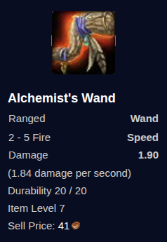

# mod-starter-wands

*This module ([repo](https://github.com/Protonull/mod-starter-wands)) was created for [OrinWoW](https://github.com/Protonull/OrinWoW), but can be used on any [azerothcore-wotlk](https://github.com/azerothcore/azerothcore-wotlk) server.*

This module gives all newly-created players with the ability to use wands a custom starter wand.



## Usage

Players may need to delete their item cache for the wand to become usable.

## Licence

Given the terms of AzerothCore's APGL licence, this module is unfortunately obligated to adopt the same. As such, this project is likewise licensed under APGL.

## Backstory

I had the idea that spellcasters should start off with a wand, similar to how hunters start off with a gun, bow, or crossbow. Getting this implemented though has been a *'fun'* journey.

Starter outfits are determined by the `charstartoutfit_dbc` table within `acore_world`, except that it's empty. I'm not entirely sure why. But modifying the starter outfits means populating this table with the defaults.

AzerothCore [recommends](https://www.azerothcore.org/wiki/how-to-import-dbc-data-in-db) using [node-dbc-reader](https://github.com/wowgaming/node-dbc-reader) to extract data from the dbc files into SQL queries. If you don't already have the dbc files, you can download them [here](https://github.com/wowgaming/client-data/releases/). Problem is that it doesn't tell you where to clone it, so I immediately ran into issues where it could not find the dbc files. That meant editing file paths within the source code.

It worked at first, allowing me to [modify Paladin blessings to last 30 minutes](https://github.com/Protonull/OrinWoW/commit/3d901c332c13713c7199e5e9489aa3a200894776), but this [didn't work](https://discord.com/channels/217589275766685707/1255602330431127753/1404928354964078642) for `CharStartOutfit` due to an out-of-bounds error, *sigh*.

It turns out that the dbc file's [schema](https://wowdev.wiki/DB/CharStartOutfit#3.0.8.8905-3.3.5.12340) defines the race, class, gender, and outfit-id values as bytes (u8), whereas node-dbc-reader [defines](https://github.com/wowgaming/node-dbc-reader/blob/f164222a278e8c110c30b1a5e68b682f56f4b20c/src/schemas/azerothcore/charstartoutfit.json#L6-L21) these as uints (u32). No wonder it was overflowing! A little more editing to the source code fixed this, producing a working SQL query. The `charstartoutfit_dbc` is now populated!

So I look at the `charstartoutfit_dbc` table, thinking I can find the "ranged weapon" slot by seeing what column hunters use for their ranged weapons. I assumed that it'd match the `SLOT_RANGED` enum (17), so the weapon would be in `ItemID_18` (since the database columns are 1-based indexed). *NOPE*. I Ctrl-F'd for `2508` (Old Blunderbuss) and not only do I not find it in `ItemID_18`, but in *multiple* different columns.

As it turns out, each row in `charstartoutfit_dbc` is essentially a list of items, not a slot-to-item map. Putting an item into a particular column means nothing. In fact, putting anything in any of the `DisplayItemID_*` or `InventoryType_*` columns means nothing (they are not used by the server). This makes editing starter outfits *extremely* obnoxious.

If `charstartoutfit_dbc` worked as expected, where each column corresponds to the `CharacterSlot` enum, then you could trivially update starter outfits, eg:
```sql
--                                                                  3 = Hunter
UPDATE charstartoutfit_dbc SET `ItemID_18` = 2508 WHERE `ClassID` = 3;
```
This would then set ALL hunter starter-outfits to have an Old Blunderbuss, and it'd safely override any previous custom ranged weapon for hunters.

Instead, you are required to know where each ranged-weapon lies for each race-class-gender combo. Usually the gender doesn't matter but the possibility is there. Here is the equivalent SQL:
```sql
-- Orcs, Dwarves, Blood Elves, and Draenei
UPDATE charstartoutfit_dbc SET `ItemID_8` = 2508 WHERE `ClassID` = 3 AND `RaceID` IN (2, 3, 10, 11);
-- Night Elves and Tauren
UPDATE charstartoutfit_dbc SET `ItemID_6` = 2508 WHERE `ClassID` = 3 AND `RaceID` IN (4, 6);
-- Trolls
UPDATE charstartoutfit_dbc SET `ItemID_5` = 2508 WHERE `ClassID` = 3 AND `RaceID` = 8;
```
This is absurd and extremely bug-prone.

For example, this module is giving wands to classes that don't start out with them. Presumably, it would be best to put it wand in the first-empty column, right? Except... ***HOW?!***

At this point, I abandoned the idea of using the database to modify starter outfits. It's mod time! The most obvious solution was to create a `PlayerScript`, override `OnPlayerCreate`, and assign the item there, right? Haha, *right?* NOPE! Turns out that despite the method giving you a `Player` instance, you're not *really* supposed to do anything with it. Is this documented anywhere? Haha, no.

Luckily there's `OnPlayerFirstLogin`, which *does* work, thank goodness: I was 🤏 close to committing seppuku. Giving players the starter wand in-script also means not limiting the starter wand to *just* priests, mages, and warlocks, but to anyone who has the wand skill at time of character creation. Feel free to give druids the wand-skill :)
